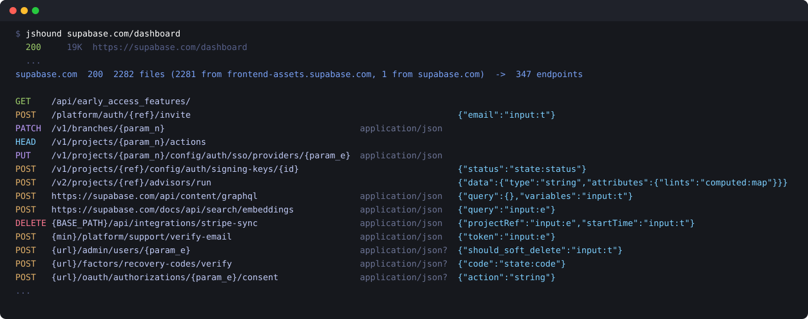

# jshound

Recover every request a web app is built to make from the JavaScript it ships: method, URL, body,
content type and headers.



A single page app hands its whole API client to the browser. The URL, the method, the field names it
sends and the headers it attaches are all in the bundle, so if the bundle can be read properly the
API does not have to be discovered by clicking through the UI. jshound fetches the bundle, follows
every lazily loaded chunk, parses all of it, and writes down the requests.

It sends nothing to the app's API. The only requests it makes are GETs for the page and the
JavaScript a browser would download, and everything after that happens against files on disk.

## Install

```bash
git clone https://github.com/AmbitSecurity/jshound && cd jshound
npm install
python3 -m venv .venv && source .venv/bin/activate
pip install -e ".[fetch]"
```

Needs Python 3.9 or newer and Node 18 or newer.

## Usage

```bash
jshound supabase.com/dashboard
```

Each request it makes is printed as it goes, with its status:

```console
$ jshound supabase.com/dashboard
  200     19K  https://supabase.com/dashboard
  200    109K  https://frontend-assets.supabase.com/studio/1ee88e0fee29/_next/static/chunks/0c0hxoamwjsbw.js?dpl=dpl_9C2bDPvRyr2U75ouX1tQDMb1R81V
  ...
  404     16K  https://supabase.com/dist/cli/index.js
  ...
supabase.com  200  214 files (213 from frontend-assets.supabase.com, 1 from supabase.com)  ->  226 endpoints
              1 declared chunk(s) could not be fetched
              -> .jshound/supabase.com/endpoints.txt  (also requests.jsonl, urls.txt, openapi.json)
```

213 of the 214 files came from `frontend-assets.supabase.com`, which is where the build lives and
which nobody would put in a scope file. The 404 is a chunk the build declares that neither host
served, and the summary says so rather than skipping it. Then every request, one per line (five of the
226 here):

```
POST   /platform/auth/{ref}/otp                                        {"phone":"state:phone"}
POST   https://supabase.com/docs/api/search/fts     application/json   {"query":"computed:trim"}
DELETE {BASE_PATH}/api/integrations/stripe-sync     application/json   {"projectRef":"input:e","startTime":"input:t"}
POST   {url}/factors/recovery-codes/verify          application/json?  {"code":"state:code"}
POST   {graphql}                                    application/json   {"operationName":"saveConsents","variables":{"consents":"[NewCreateConsentInput]","consentMeta":"ConsentMeta","consentString":"ConsentString"}}
```

Several targets at once, or a list on stdin:

```bash
jshound app.example.com api.example.com
cat scope.txt | jshound
```

## What gets saved

Everything goes to `.jshound/<host>/`, or to `-o DIR`:

| | |
|---|---|
| `endpoints.txt` | the table above, one request per line |
| `requests.jsonl` | one JSON object per request: `method`, `url`, `body`, `content_type`, `headers`, `graphql`, and the page and file it came from |
| `urls.txt` | `METHOD URL` for the requests whose host is known, for tools that take a list |
| `openapi.json` | an OpenAPI 3 document, to import into Burp, Caido or Postman |
| `js/` | every file that was fetched |

Nothing is truncated. A long body is a long line.

To read it again without touching the network, point jshound at the folder:

```bash
jshound .jshound/supabase.com/js
```

## Reading the output

- **A full URL** is what the browser itself resolves: a `fetch`, an `XMLHttpRequest`, a beacon or a
  WebSocket with a path, resolved against the page it ran on.
- **A bare path** like `/platform/auth/{ref}/otp` came through the app's own API client, which puts
  a base URL in front of it. The base is set somewhere jshound did not follow, so the host is not
  guessed. On supabase that base is the API host, not `supabase.com`.
- **`{name}` at the start**, like `{BASE_PATH}` or `{url}`, is a base the code keeps in a variable,
  named the way the code names it.
- **`{name}` in a path** is a parameter. `{param_n}` means the code gave it no better name.
- **In a body**, each value says where the field's value comes from: `input:` is an argument,
  `state:` is a property of an object, `computed:` is the result of a call, `?` is not known.
- **`application/json?`** is a content type inferred from the other requests in the same file, not
  read at the call site. **`~{...}`** is a body whose listed fields are real but incomplete.
- **`{graphql}`** is a GraphQL operation. Every operation goes to one endpoint, so the operation
  name, type and variables are the request, and they are written as its body.

## Options

| | |
|---|---|
| `-o DIR` | where results go (default `.jshound/<host>`) |
| `-q` | do not print each request as it is made |
| `-v` | also print the analysis log |
| `--max-chunks N` | stop after this many lazy chunks (default 5000). Hitting it is printed, with how many were declared |
| `--no-chunks` | do not follow lazy chunks |
| `--proxy URL` | send every request through a proxy (or set `JSHOUND_PROXY`) |
| `--proxy-ca FILE` | the CA certificate of a proxy that intercepts TLS |
| `--client PROFILE` | pin one browser TLS profile instead of rotating when blocked |
| `--allow-private` | allow URLs in private address space (see Scope) |

## Try it offline

`examples/demo-app` is a five line webpack bundle and its page, already on disk:

```console
$ jshound examples/demo-app
GET    https://demo-app.test/api/feature-flags
POST   https://demo-app.test/t/events                                  {"sid":"?","evt":"?"}
DELETE https://demo-app.test/v1/sessions/current
POST   {baseUrl}/v1/media                         multipart/form-data  {"file":"file-upload"}
POST   {baseUrl}/v1/subscribe                     application/json     {"email":"computed:trim","pageUri":"state:href"}
GET    {baseUrl}/v1/users/{param_o}/profile
```

Six requests across four different sinks (`fetch`, `XMLHttpRequest.open`, `sendBeacon`, and a class
wrapping `fetch`), with a verb on each. The three under `{baseUrl}` belong to a class that takes its
base URL as a constructor argument, which is why the host is not filled in. A test runs this command
and checks the output above against it, so it cannot quietly stop being true.

## How it works

1. **Collect the whole bundle.** A code split app loads most of its code later and never writes
   those URLs down. Webpack ships a function that builds them, so jshound reads that function out of
   the syntax tree, evaluates it for every chunk id it can find, fetches the results, and repeats
   until a round turns up nothing new. Nothing the target ships is executed.

2. **Find the call sites, not the strings.** Every file is parsed with Babel, looking for the places
   a request is made: `fetch`, `axios`, `XMLHttpRequest.open`, `sendBeacon`, `EventSource`,
   `WebSocket`, and the wrapper most codebases put in front of them.

3. **Resolve each argument back to a value.** `${this.baseUrl}/orgs/${id}/members` is three values
   from three places, often in different files. Every export, constant and property assignment in
   the bundle is indexed first, and each argument is traced through it. A value the bundle disagrees
   about is left as a named slot rather than filled with one guess.

4. **Build the request from the call.** The method comes from the options object or the wrapper's
   default, the body from the object being serialised, the content type from a `FormData`, a
   `JSON.stringify` or an explicit header, and the headers from the client's own defaults.

## Scope

Scope governs what you may test, not what you may read. A chunk named by the page's own runtime is
that page's code wherever it is hosted: supabase's lives on `frontend-assets.supabase.com`, and
neither that nor any other CDN host is in anyone's scope file. jshound fetches those scripts and
sends those hosts nothing else.

It refuses any URL a target names in private address space (loopback, RFC1918, link local) unless
the target you gave it is itself private, or you pass `--allow-private`.

## Bundlers it handles

| bundler | lazy chunk URLs | module tree | how |
|---|---|---|---|
| webpack 5 | yes | yes | reads `__webpack_require__.u` out of the syntax tree |
| webpack 4 | yes | yes | has no `.u`, so the named URL builder is matched by shape rather than by name |
| Rspack | yes | yes | webpack-compatible, usually emitting ESM |
| Turbopack | yes | n/a | no builder at all; the chunk list is a literal array |
| Vite / Rollup | yes | n/a | paths are written down (`__vite__mapDeps`); flat ESM has no registry to walk |
| esbuild | yes | n/a | same |
| Parcel | yes | n/a | the runtime global is suffixed per build (`parcelRequire5707`) and the chunk table is an object, not an array |
| Metro (React Native) | n/a | n/a | ships one bundle, no chunks; detected by `__METRO_GLOBAL_PREFIX__`, since its `__d`/`__r` registry is too generic to match |
| webpack Module Federation | yes | yes | the builder carries no id map, so ids are taken from the `__webpack_require__.e(480)` call sites |

Module ids come in three flavours: numeric (`{134: fn}`), named (`{"src/vector/app.tsx": fn}`) and
deterministic (`{"++os": fn}`). The registry is recognised by *shape*, because a key-format test
rejected 848 real modules on GitLab.

## What it does not do

- **It does not confirm anything against the server.** These are the requests the client is built
  to make. Some will be gone or gated.
- **It does not log in.** Code that only loads for a signed in user is not in what an anonymous
  browser downloads, so its requests are not found.
- **It can be blocked.** A WAF that challenges the first request is reported as `blocked by <vendor>`.
  jshound imitates the newest Chrome, Firefox and Safari its curl_cffi knows, in that order, so keep
  curl_cffi current: a year-old browser gets challenged where a current one gets through.
  `--proxy` helps with rate limits and IP bans but not with a challenge.
- **An app that builds its script tags at runtime** hides those scripts from a fetch, and their
  requests are missing.

## Contributing

[CONTRIBUTING.md](CONTRIBUTING.md). A change to extraction is measured by diffing requests, not by
comparing totals: `bench/regress.sh` does that, and the reason it exists is in its header.

## License

MIT.
