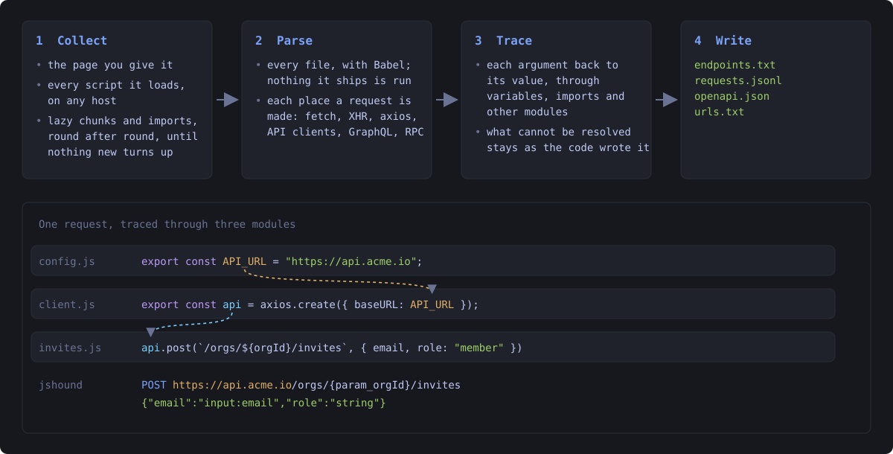

# jshound

Recover every request a web app is built to make from the JavaScript it ships: method, URL, body,
content type and headers.


A single page app ships its whole API client to the browser. jshound downloads that JavaScript,
follows every lazily loaded chunk, parses all of it, and writes down each request the code makes.

It only requests the page and the JavaScript files a browser would download. Nothing is sent to the
app's API.

## Install

```bash
git clone https://github.com/AmbitSecurity/jshound && cd jshound
python3 -m venv .venv && source .venv/bin/activate
pip install -e .
```

Needs Python 3.10 or newer and Node 18 or newer.

## Usage

```bash
jshound supabase.com/dashboard
```

```console
$ jshound supabase.com/dashboard
  307    128B  https://supabase.com/dashboard
  200     19K  https://supabase.com/dashboard/org
  200     28K  https://frontend-assets.supabase.com/studio/8617532ae1a4/_next/static/chunks/1p849pzlxcp4n.js?dpl=dpl_ESaSquAbnWrJqbvvyRh7F1qj5wWH
  ...
supabase.com  200  2282 files (2281 from frontend-assets.supabase.com, 1 from supabase.com)  ->  387 endpoints
              1 declared chunk(s) could not be fetched
              -> .jshound/supabase.com/endpoints.txt  (also requests.jsonl, urls.txt, openapi.json)
```

- It fetched the page and every script the page loads, including the 2,281 files on
  `frontend-assets.supabase.com`, where supabase's build lives.
- It found the lazily loaded chunks and imports in those files, fetched them, and repeated until no
  new files turned up.
- It read every request in the code, one per line:

```
POST    https://api.supabase.com/platform/auth/{ref}/otp                                       {"phone":"state:phone"}
DELETE  https://api.supabase.com/v1/projects/{param_n}/functions/{param_e}
DELETE  https://supabase.com/dashboard/api/integrations/stripe-sync     application/json   {"projectRef":"input:e","startTime":"input:t"}
POST    https://supabase.com/docs/api/search/fts                        application/json   {"query":"computed:trim"}
```

Several targets at once, or a list on stdin:

```bash
jshound app.example.com api.example.com
cat scope.txt | jshound
```

Files already on disk, such as a previous run's `js/` folder, are read without touching the network:

```console
$ jshound examples/demo-app
GET    https://demo-app.test/api/feature-flags
POST   https://demo-app.test/t/events                                  {"sid":"?","evt":"?"}
DELETE https://demo-app.test/v1/sessions/current
POST   {baseUrl}/v1/media                         multipart/form-data  {"file":"file-upload"}
POST   {baseUrl}/v1/subscribe                     application/json     {"email":"computed:trim","pageUri":"state:href"}
GET    {baseUrl}/v1/users/{param_o}/profile
```

## What gets saved

Everything goes to `.jshound/<host>/`, or to `-o DIR`:

| | |
|---|---|
| `endpoints.txt` | the table above, one request per line |
| `requests.jsonl` | one JSON object per request: `method`, `url`, `body`, `content_type`, `headers`, `graphql` or `rpc`, and the page and file it came from |
| `urls.txt` | `METHOD URL` for the requests whose host is known, for tools that take a list |
| `openapi.json` | an OpenAPI 3 document, to import into Burp, Caido or Postman |
| `js/` | every file that was fetched |

## Reading the output

- **`{...}`** is a value jshound could not resolve, written as the code writes it: `{baseUrl}`,
  `{window.__CONFIG__.apiBaseUrl}`. In a path, `{ref}` is a parameter, and `{param_o}` is the
  function parameter `o`.
- **A path with no host**, like `/api/surveys/`, goes through code jshound does not follow to its
  base yet. `requests.jsonl` names the file it came from.
- **Body values** say where each field's value comes from: `input:` an argument, `state:` a property
  of an object, `computed:` the result of a call, `?` unknown.
- **`application/json?`** is a content type inferred from the file's other requests rather than read
  at the call site. **`~{...}`** is a body that has more fields than the ones listed.
- **`{graphql}`** is a GraphQL operation, with its name, type and variables as the body.

## How it works



## Bundlers it handles

| bundler | lazy chunk URLs | module tree | how |
|---|---|---|---|
| webpack 5 | yes | yes | reads `__webpack_require__.u` out of the syntax tree |
| webpack 4 | yes | yes | has no `.u`, so the named URL builder is matched by shape rather than by name |
| Rspack | yes | yes | webpack-compatible, usually emitting ESM |
| Turbopack | yes | n/a | no builder at all; the chunk list is a literal array |
| Vite / Rollup | yes | n/a | paths are written down (`__vite__mapDeps`); flat ESM has no registry to walk |
| esbuild | yes | n/a | same |
| Parcel | yes | n/a | the runtime global is suffixed per build (`parcelRequire5707`) and the chunk table is an object, not an array |
| Metro (React Native) | n/a | n/a | ships one bundle, no chunks; detected by `__METRO_GLOBAL_PREFIX__` |
| webpack Module Federation | yes | yes | the builder carries no id map, so ids are taken from the `__webpack_require__.e(480)` call sites |

## Scope

jshound requests the target you give it, and the JavaScript files that target's pages load, wherever
they are hosted. For supabase that is mostly `frontend-assets.supabase.com`. These are public static
files that any visitor's browser downloads. Those other hosts get nothing but those GETs.

It refuses any URL a target names in private address space (loopback, RFC1918, link local), unless
the target you gave it is itself private or you pass `--allow-private`.

## Options

| | |
|---|---|
| `-o DIR` | where results go (default `.jshound/<host>`) |
| `-q` | do not print each request as it is made |
| `-v` | also print the analysis log |
| `--max-chunks N` | stop after this many lazy chunks and imports (default 50000) |
| `--no-chunks` | do not follow lazy chunks |
| `--proxy URL` | send every request through a proxy (or set `JSHOUND_PROXY`) |
| `--proxy-ca FILE` | the CA certificate of a proxy that intercepts TLS |
| `--client PROFILE` | pin one browser TLS profile instead of rotating when blocked |
| `--allow-private` | allow URLs in private address space (see Scope) |

## Limitations

- **The requests are read from code, not tested.** A request can be in the bundle and still be gone
  from the server, behind a feature flag, or limited to admins. jshound tells you what the client
  can send, not what the server accepts.
- **Code that loads only after sign-in is not found.** If an app downloads its billing pages only
  once you are logged in, jshound, which is not logged in, never sees that code.
- **A WAF can block it.** If the first request gets a challenge page, for example Cloudflare's, the
  run reports `blocked by Cloudflare` and reads nothing. jshound imitates the newest Chrome, Firefox
  and Safari that curl_cffi knows, so keep curl_cffi up to date. `--proxy` helps with rate limits and
  IP bans, not with challenges.
- **Scripts added at runtime are missed.** A script the page inserts with
  `document.createElement("script")`, using a URL it gets from an API call, is not in anything
  jshound downloads.

## Contributing

See [CONTRIBUTING.md](CONTRIBUTING.md).

## License

MIT.
